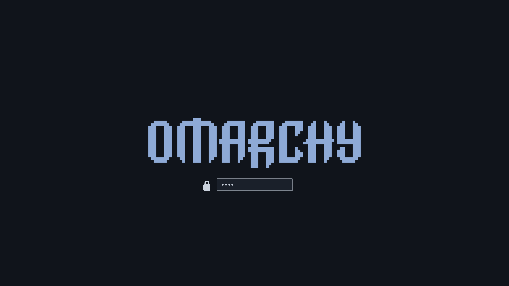

# omarchy-wizard-theme

A minimal Omarchy theme: slate blue-grey on near black, with pixel art icons.



## Why

Gandalf the Grey on a 1990s Unix workstation. Every colour is a grey except
one blue accent and one red for errors. The icons are
[Papirus-Pixel](https://github.com/cassius66/papirus-pixel), Papirus redrawn
on a 24 by 24 grid in a 16 colour palette.

## Setup

Install the icons first. The theme names them but cannot install them.

```bash
omarchy pkg add papirus-icon-theme
curl -fsSL https://raw.githubusercontent.com/cassius66/papirus-pixel/master/pixel/install.sh | bash
```

Then install the theme:

```bash
omarchy theme install https://github.com/cassius66/omarchy-wizard-theme
```

Update it later with `omarchy theme update`.

## Usage

To change a colour, edit `colors.toml`, then regenerate the images and
reapply:

```bash
tools/images.sh
omarchy theme set wizard
```

`tools/images.sh` needs ImageMagick 7 and an installed Omarchy.

## Structure

| Path | Holds |
|---|---|
| `colors.toml` | Every colour. Omarchy generates the terminal, editor, bar and Hyprland configs from it. |
| `icons.theme` | The icon theme name, `Papirus-Pixel`. |
| `backgrounds/1-omarchy.png` | The one wallpaper, 3840 by 2160. |
| `unlock.png` | The wordmark for the boot and disk unlock screen. |
| `preview-unlock.png` | The thumbnail for that screen's picker. |
| `tools/images.sh` | Regenerates the three images from `colors.toml`. |
| `docs/adr/` | Decision records. |

## Not Done

- Does not install the icons. Without them GTK falls back to its default
  icons.
- Ships no `preview.png`. The theme picker shows the wallpaper instead.
- Ships no Neovim, VS Code or terminal config. Omarchy drops those from a
  theme installed from git and generates its own from `colors.toml`.
- Once Papirus-Pixel is in `~/.local/share/icons`, the Super+Space launcher
  shows its icons under every Omarchy theme, not only this one.

## Decisions

See [docs/adr/](docs/adr/README.md).

- [0001. Icons come from Papirus-Pixel, installed per user](docs/adr/0001-icons-come-from-papirus-pixel-installed-per-user.md)
- [0002. colors.toml is the only source of colour](docs/adr/0002-colors-toml-is-the-only-source-of-colour.md)
- [0003. Greys, one blue accent, and red for errors](docs/adr/0003-greys-one-blue-accent-and-red-for-errors.md)

## License

The Unlicense, see [LICENSE](LICENSE). The pixel wordmark in the three
images is Omarchy's, under the MIT license in
[docs/omarchy-license.txt](docs/omarchy-license.txt).
